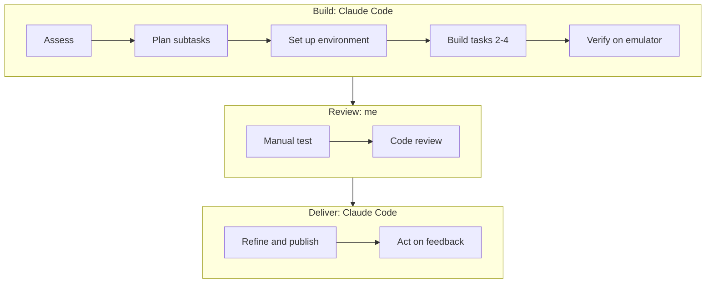

# AI Usage: How These Apps Were Built

I built these apps with **Claude Code**, Anthropic's AI coding agent. This
document describes the workflow I followed, how each task was broken down into
subtasks, and which parts Claude Code did and which parts I did.

## At a glance

- **AI tool:** Claude Code was the only AI tool I used. I ran it in the Claude
  desktop app (Claude Opus 5) to build the apps on 8 October 2026, and in the
  VS Code extension (Claude Opus 5.5) to publish them and act on the review
  feedback.
- **Claude Code:** set up the development environment (apart from the Android
  Studio plugins, see [Task 1](#task-1-install-android-studio-with-flutter-support)),
  wrote all of the code, tests and documentation, built the APKs and checked
  them on an emulator.
- **Me:** I directed the work, decided on scope and delivery, installed the
  Android Studio plugins, tested every task manually and reviewed the code. I can explain how it works, including the
  Task 4 synchronization. I did not write or edit code by hand.

## Workflow

1. **Assess.** I gave Claude Code the four tasks and asked it to separate what
   it could do on its own from what needed me. The one set-up step it could
   not do from the command line was installing the Flutter and Dart plugins
   inside Android Studio, which needs the IDE's interface. I did that step
   myself.
2. **Plan subtasks.** Claude Code broke the work into steps and tracked them in
   a to-do list as it worked. The plan changed once: it first meant to show the
   apps in a web browser, but Flutter Web cannot run `dart:isolate`, so it used
   an Android emulator instead.
3. **Set up the environment.** Task 1, done from the command line. When
   `flutter doctor` asked for Android SDK platform 36, that was installed too.
4. **Build tasks 2 to 4.** In the order of the assignment, each one with
   automated tests. The first version was a single app with one screen per
   task.
5. **Verify on the emulator.** Claude Code ran `flutter analyze` and
   `flutter test`, built the APK, installed it on the emulator with `adb`,
   drove each screen with `adb` input commands and checked the screenshots. The
   first release build failed because of the 260-character path limit on
   Windows, so it rebuilt the APK from a shorter folder.
6. **Manual test.** I tested each task on the emulator myself.
7. **Code review.** I reviewed the code and the project structure. Because the
   code is reviewed in English, I asked for English throughout and a simple
   structure.
8. **Refine and publish.** Claude Code translated the remaining Portuguese
   text, cleaned up generated files, wrote the README and rebuilt the APK. I
   created the repository on GitHub, and Claude Code committed and pushed the
   code to it.
9. **Act on feedback.** After the review feedback, it split the project into
   three standalone apps, built and checked one APK per app, retook the
   screenshots and wrote this document. I then installed the three APKs and
   tested each app myself.

## Tasks and subtasks

Each table lists the subtasks carried out for one task and who did them.

### Task 1: Install Android Studio with Flutter support

| # | Subtask | Who | How |
| --- | --- | --- | --- |
| 1.1 | Check what the machine already had | Claude Code | Looked for Git, winget, existing SDKs and free disk space |
| 1.2 | Install JDK 17 and Android Studio | Claude Code | `winget` |
| 1.3 | Install the Flutter SDK | Claude Code | `git clone` of the stable channel |
| 1.4 | Install the Android SDK and accept its licenses | Claude Code | `sdkmanager`: platform-tools, platform 36, build-tools 36.0.0 |
| 1.5 | Connect Flutter to the SDK and JDK, and check the set-up | Claude Code | `flutter config`, `flutter doctor` |
| 1.6 | Create an Android emulator | Claude Code | Android 15 system image, `avdmanager` |
| 1.7 | Install the Flutter and Dart plugins in Android Studio | Me | Android Studio's plugin manager, since this step needs the IDE's interface |

### Task 2: Hello World

| # | Subtask | Who | How |
| --- | --- | --- | --- |
| 2.1 | Create the Flutter project (Android only) | Claude Code | `flutter create` |
| 2.2 | Build the screen: an app bar and a centered "Hello World" | Claude Code | [`lib/main.dart`](task2_hello_world/lib/main.dart) |
| 2.3 | Test that "Hello World" is displayed | Claude Code | One widget test |
| 2.4 | Build the APK and check it on the emulator | Claude Code | Release build, `adb`, screenshot |

### Task 3: Label, EditText and button

| # | Subtask | Who | How |
| --- | --- | --- | --- |
| 3.1 | Map the Android widgets named in the task to Flutter | Claude Code | `EditText` → `TextField`, label (`TextView`) → `Text` |
| 3.2 | Lay out the label, the text field and the button | Claude Code | A `Column` in [`lib/main.dart`](task3_ui_layout/lib/main.dart) |
| 3.3 | Show the text on the label when the button is pressed | Claude Code | `TextEditingController` and `setState`; the keyboard's done key does the same |
| 3.4 | Handle an empty field and close the keyboard | Claude Code | A hint replaces the empty text; `unfocus()` |
| 3.5 | Test both behaviors | Claude Code | Two widget tests |
| 3.6 | Build the APK and check it on the emulator | Claude Code | Typed "Hello Alon!" with `adb`, pressed the button, took screenshots |

### Task 4: Two synchronized threads

| # | Subtask | Who | How |
| --- | --- | --- | --- |
| 4.1 | Choose the concurrency model | Claude Code | Dart isolates, since Dart has no threads that share memory |
| 4.2 | Design the synchronization | Claude Code | A single turn token passed between the two isolates |
| 4.3 | Implement the two workers and connect them | Claude Code | `Isolate.spawn`, ports and a short handshake in [`lib/counter_isolates.dart`](task4_multithreading/lib/counter_isolates.dart) |
| 4.4 | Build the screen | Claude Code | Label colored by isolate, start and stop buttons, produced sequence |
| 4.5 | Test the order and the stop | Claude Code | Exactly 1 to 20 in order, each number from the right isolate; `stop()` interrupts the count; the screen starts idle |
| 4.6 | Build the APK and check it on the emulator | Claude Code | Screenshots while idle, counting and finished |

The design is explained in the
[Task 4 README](task4_multithreading/README.md#how-the-synchronization-works).

### Review and delivery

| Subtask | Who | How |
| --- | --- | --- |
| Test every task manually | Me | On the emulator: first the single-app version, then each of the three APKs |
| Review the code and the project structure | Me | Code, naming and folder layout |
| Translate UI text, comments and tests into English | Claude Code | At my request, because the code is reviewed in English |
| Clean up generated files and write the README | Claude Code | README with screenshots from the emulator |
| Create the GitHub repository | Me | On my GitHub account |
| Commit and push the code | Claude Code | `git init`, commit and push to that repository |
| Split into three standalone apps and add the APKs | Claude Code | After the review feedback; each APK checked again on the emulator |
| Write this document | Claude Code | From the session history and my account of what I did |

## How the result was checked

- `flutter analyze` reports no issues in any of the three apps.
- `flutter test` passes in all three apps (six tests in total).
- Claude Code installed and ran each release APK on an Android 15 emulator
  before committing it. The screenshots in the README come from those runs.
- I then installed the three APKs on the emulator and tested each app by hand.

## Task 4, spec-driven version

After the second review, Task 4 was redone from scratch in
[`task4_spec_driven/`](task4_spec_driven/), again with Claude Code (Claude
Opus 5.5, in VS Code). This time each phase produced its own document while
the work happened, instead of a summary written afterwards:

| Phase | Document | Who |
| --- | --- | --- |
| Functional specification | [`01-functional-spec.md`](task4_spec_driven/docs/01-functional-spec.md) | Claude Code drafted it from the task; I reviewed and approved it. |
| Technical specification | [`02-technical-spec.md`](task4_spec_driven/docs/02-technical-spec.md) | Claude Code drafted it from the approved functional specification; I reviewed and approved it. |
| Implementation | [`03-implementation.md`](task4_spec_driven/docs/03-implementation.md) | Claude Code wrote the plan, then the code and tests from the technical specification, and recorded the results of each step. |

I raised that the task asks for threads rather than isolates, so this version
uses two real Kotlin threads; the technical specification records the
alternatives and the decision. Each document was committed after it was
approved, so the Git history shows the order of the phases. After the build, I
installed the APK on the emulator and tested the app myself.

---

This document was written with Claude Code after the work was finished, from
the session history and my own account of what I did.
