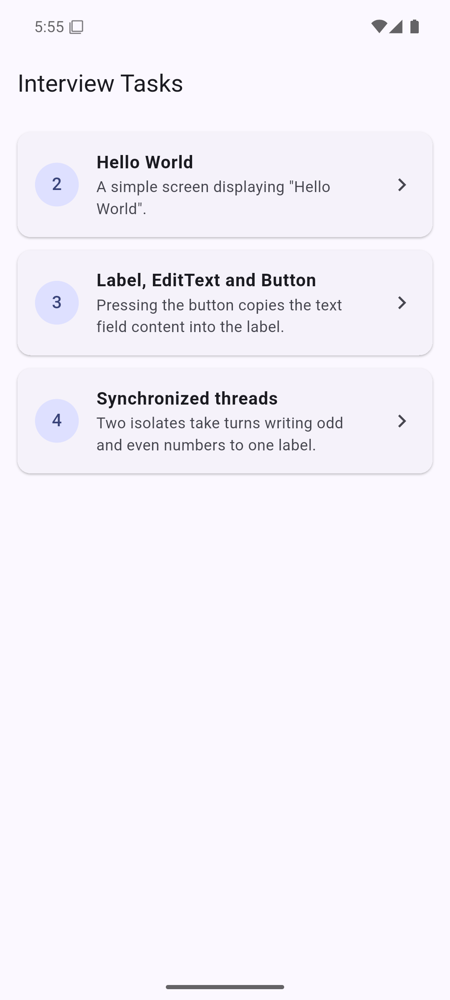
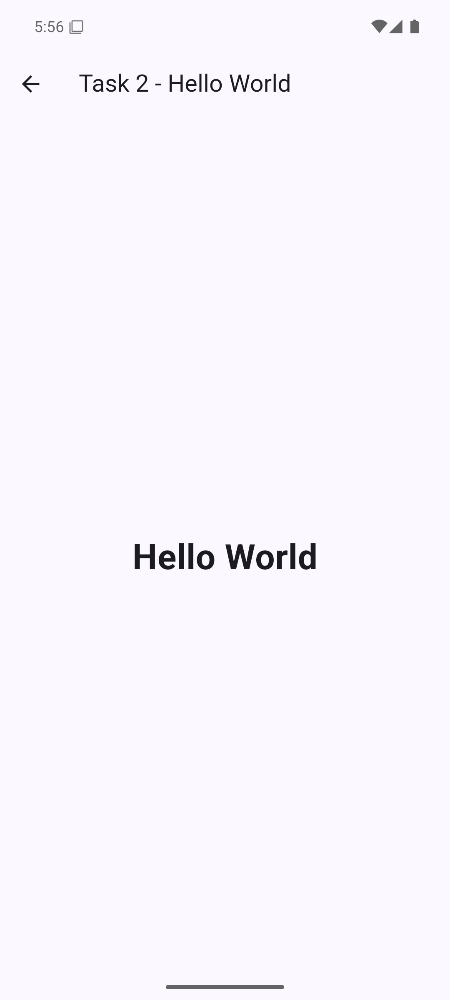
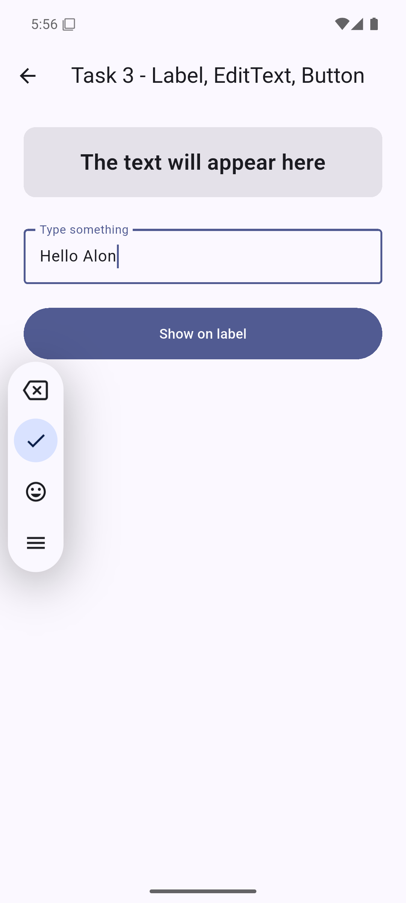
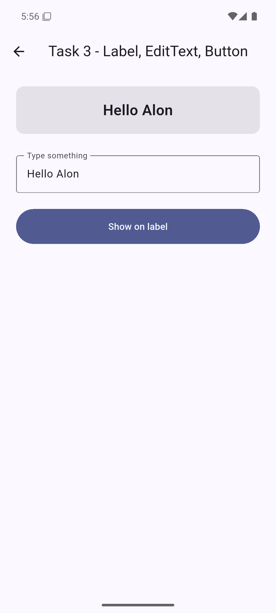
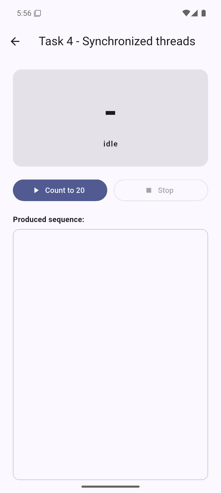
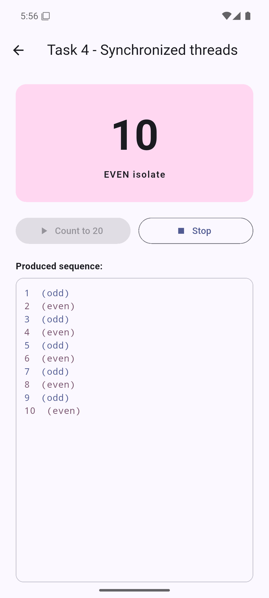

# Interview Tasks

A single Flutter app that solves the four interview tasks. The home screen lists
the tasks and each one opens on its own screen.

| Task | What was asked | Where it lives |
| ---- | -------------- | -------------- |
| 1 | Install Android Studio with Flutter support | Flutter 3.47 stable + Android SDK 36 + JDK 17; this project builds and runs on an emulator |
| 2 | "Hello World" app | [`lib/screens/task2_hello_world.dart`](lib/screens/task2_hello_world.dart) |
| 3 | Label + EditText + Button; the button shows the text on the label | [`lib/screens/task3_label_edittext_button.dart`](lib/screens/task3_label_edittext_button.dart) |
| 4 | Two synchronized threads counting odd/even numbers into one label | [`lib/counter_isolates.dart`](lib/counter_isolates.dart) (logic) + [`lib/screens/task4_sync_threads.dart`](lib/screens/task4_sync_threads.dart) (UI) |

## Requirements

- Flutter 3.47 or newer (Dart 3.13+)
- JDK 17
- Android SDK platform 36 and build-tools 36.0.0

The app targets Android only: task 4 uses `dart:isolate`, which Flutter Web does
not support, so the `web/` folder was removed on purpose.

## Running

```
flutter pub get
flutter run
```

## Tests

```
flutter test
```

Five tests, all passing:

- `test/widget_test.dart` - task 2 renders "Hello World"; task 3 copies the text
  field into the label and shows a hint when the field is empty.
- `test/counter_isolates_test.dart` - the two isolates produce exactly
  `1, 2, 3, ... 20` in order with every odd number coming from the odd isolate
  and every even number from the even isolate; `stop()` interrupts the count.

`flutter analyze` reports no issues.

## Task 4: how the synchronization works

Dart has no threads that share mutable memory. Its concurrency model is based on
_isolates_: each isolate owns its heap and event loop and they communicate only
through messages (`SendPort` / `ReceivePort`). So synchronization is not done
with `synchronized` / `wait()` / `notify()` as it would be in Java, but by
passing a single **turn token** back and forth.

Exactly one token exists, so only one isolate is ever allowed to write at a
time, which guarantees the `1, 2, 3, 4, ...` order:

```
odd  -> emits 1 -> hands the token over -> waits
even -> emits 2 -> hands the token over -> waits
odd  -> emits 3 -> ...
```

Implementation notes:

- `_counterWorker` is a top-level function, as required by `Isolate.spawn`.
- Each worker blocks on a `StreamIterator` over its own `ReceivePort`, so a
  worker only resumes when it receives the token.
- At startup the two workers exchange ports through a short handshake. The even
  worker is wired first so its partner port always arrives before the first
  token.
- `stop()` kills both isolates; the screen calls it from `dispose()`.
- The UI isolate never blocks: it only listens to the ticks and calls
  `setState`.

The equivalent on native Android would be two `Thread`s sharing a lock, using
`wait()` / `notifyAll()` on a shared "whose turn is it" flag and posting the
label update with `runOnUiThread`.

## Project structure

```
lib/
  main.dart                              home screen with the task list
  counter_isolates.dart                  task 4 synchronization logic
  screens/
    task2_hello_world.dart
    task3_label_edittext_button.dart
    task4_sync_threads.dart
test/
  widget_test.dart
  counter_isolates_test.dart
docs/screenshots/                        screenshots of the running app
android/                                 Android project
```

## Screenshots

Captured on an Android emulator (Pixel, API 36).

| Home                                 | Task 2                                             |
| ------------------------------------ | -------------------------------------------------- |
|  |  |

| Task 3 - before                           | Task 3 - after pressing the button      |
| ----------------------------------------- | --------------------------------------- |
|  |  |

| Task 4 - idle                         | Task 4 - counting                             | Task 4 - finished                             |
| ------------------------------------- | --------------------------------------------- | --------------------------------------------- |
|  |  |  |
