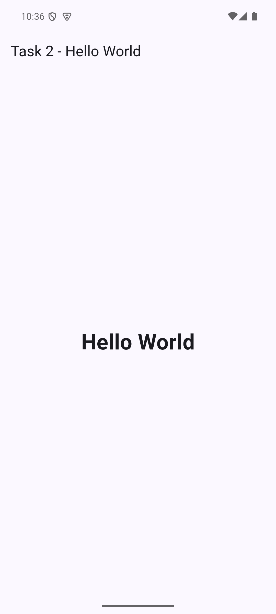
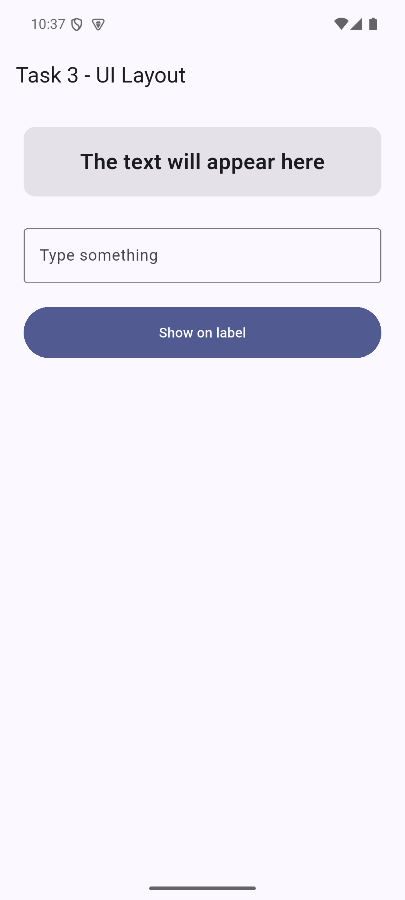
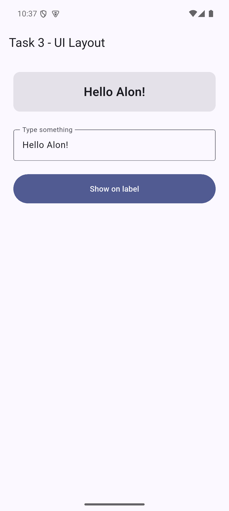
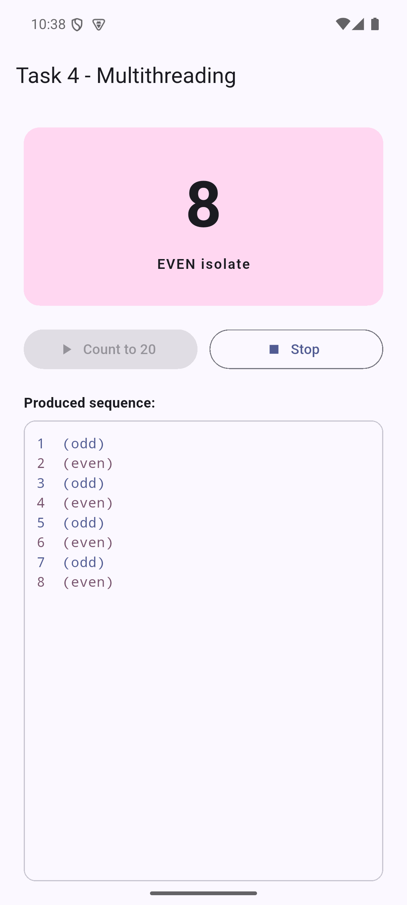
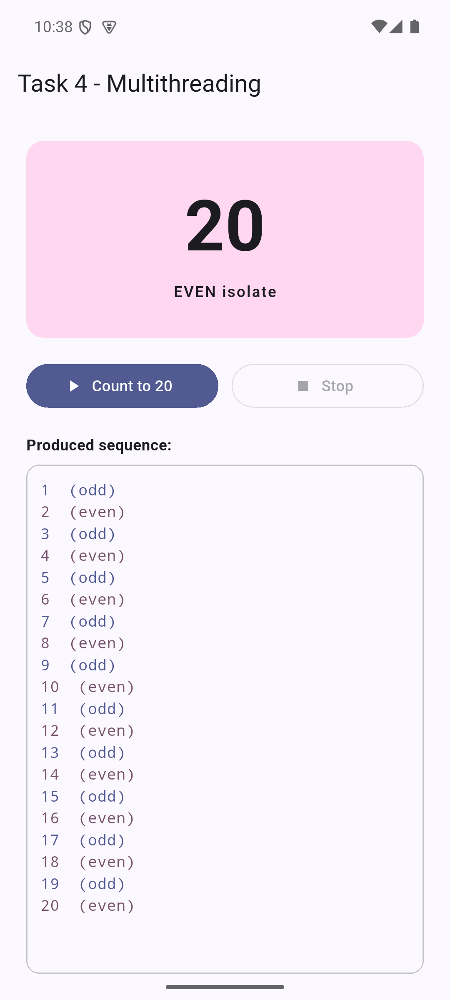

# Interview Tasks

Solutions to the Flutter interview tasks. Tasks 2, 3 and 4 are three standalone
Android apps. Each one has its own folder, its own tests and a release APK that
is ready to install.

| Task | App | Source | APK |
| ---- | --- | ------ | --- |
| 1. Install Android Studio with Flutter support | - | [Environment](#environment) | - |
| 2. Hello World | Hello World | [`task2_hello_world/`](task2_hello_world/) | [`task2_hello_world.apk`](apk/task2_hello_world.apk) |
| 3. Label, EditText and button | UI Layout | [`task3_ui_layout/`](task3_ui_layout/) | [`task3_ui_layout.apk`](apk/task3_ui_layout.apk) |
| 4. Two synchronized threads | Multithreading | [`task4_multithreading/`](task4_multithreading/) | [`task4_multithreading.apk`](apk/task4_multithreading.apk) |

## Installing the APKs

Each app has its own application ID, so the three apps can be installed side by
side.

- **On an Android phone:** download the APK from the [`apk/`](apk/) folder, open
  it and allow installs from unknown sources when Android asks.
- **With adb** (phone or emulator):

  ```
  adb install apk/task2_hello_world.apk
  adb install apk/task3_ui_layout.apk
  adb install apk/task4_multithreading.apk
  ```

The APKs are release builds signed with Flutter's default debug key. They are
meant for testing, not for publishing on Google Play.

## Environment

Task 1 is the development environment, set up on Windows with:

- Android Studio (installed with winget)
- Flutter 3.47.6 (stable channel) and Dart 3.13.5
- JDK 17 (Microsoft OpenJDK)
- Android SDK platform 36 and build-tools 36.0.0
- An Android emulator running Android 15 (API 35)

The apps were built with the Flutter command-line tools and tested on that
emulator.

## Running from source

Each app is a regular Flutter project. Open its folder in Android Studio, or run
it from a terminal:

```
cd task2_hello_world
flutter pub get
flutter run
```

## Tests

Run `flutter test` inside each app folder. There are six tests in total and all
of them pass. `flutter analyze` reports no issues in any of the three apps.

| App | What the tests check |
| --- | --- |
| Hello World | The screen displays "Hello World". |
| UI Layout | The button copies the text field into the label. An empty field shows a hint. |
| Multithreading | The two isolates produce exactly 1 to 20 in order, each number from the right isolate. `stop()` interrupts the count. The screen starts idle. |

## Task 4 in short

Dart has no threads that share memory, so the two "threads" are two isolates.
They synchronize by passing a single turn token back and forth. Only the isolate
that holds the token may update the label, and then it hands the token to the
other one. The full explanation is in the
[Task 4 README](task4_multithreading/README.md#how-the-synchronization-works).

## AI usage

The apps were built with an AI coding agent, Claude Code.
[AI_USAGE.md](AI_USAGE.md) describes the workflow, breaks each task down into
subtasks with who did them, and explains how the result was checked.

## Repository structure

```
apk/                    release APKs, one per app
task2_hello_world/      Task 2: Hello World
task3_ui_layout/        Task 3: label, text field and button
task4_multithreading/   Task 4: two isolates counting in turns
docs/screenshots/       screenshots of the three apps
AI_USAGE.md             how AI was used to build the apps
```

## Screenshots

Captured on an Android emulator running Android 15 (API 35).

| Task 2 | Task 3, before | Task 3, after pressing the button |
| ------ | -------------- | --------------------------------- |
|  |  |  |

| Task 4, idle | Task 4, counting | Task 4, finished |
| ------------ | ---------------- | ---------------- |
|  |  |  |
