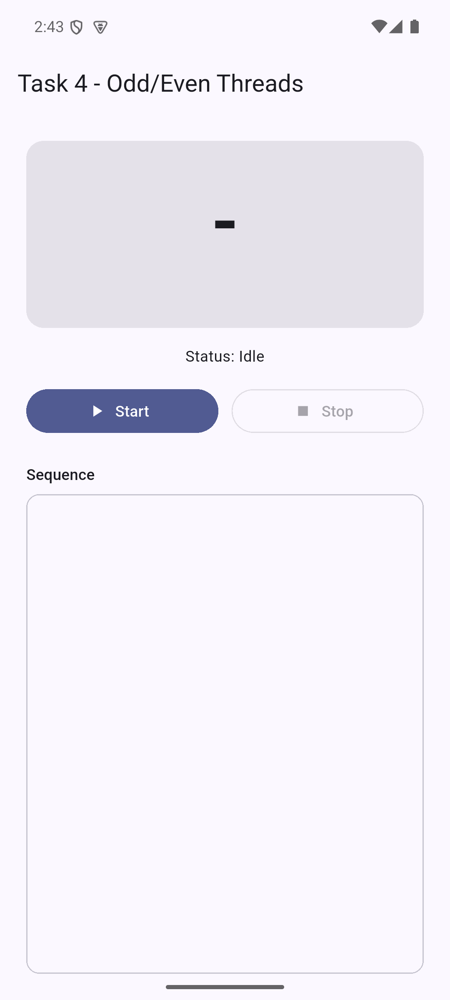
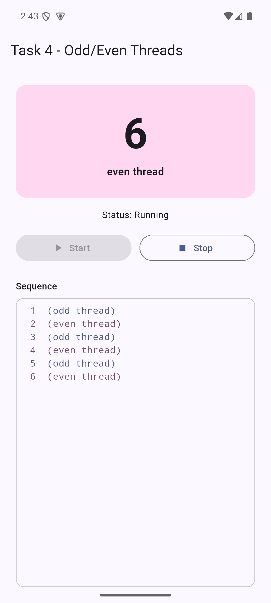
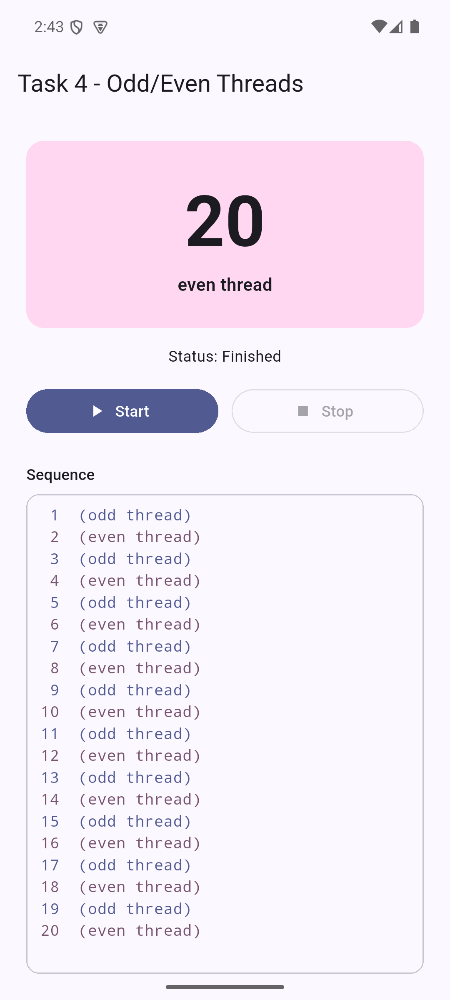
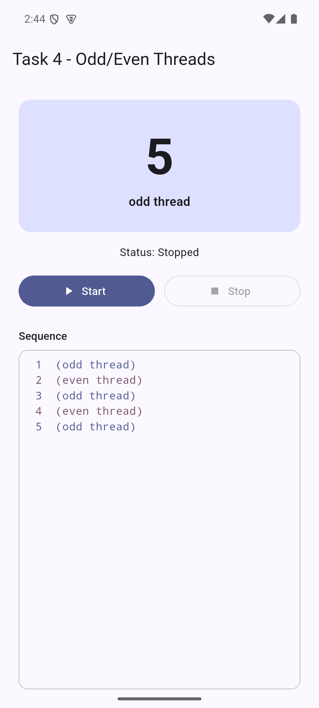

# Task 4 - Odd/Even Threads (spec-driven version)

> Implement two threads. The first thread should count odd numbers, while the
> second thread counts even numbers. Both threads should take turns updating a
> label to display the numbers in sequence (e.g., 1, 2, 3, 4, etc.) in a
> synchronized manner.

This is the multithreading task redone from scratch with a spec-driven process.
Each phase produced a document, and each document was approved before the next
phase started:

1. [Functional specification](docs/01-functional-spec.md): what the app must
   do, its states and the acceptance criteria.
2. [Technical specification](docs/02-technical-spec.md): how it is built, the
   alternatives considered, the synchronization design and the test strategy.
3. [Implementation](docs/03-implementation.md): the implementation plan, the
   progress of each step, the test results and the acceptance results.

## How it works

Two real Android threads, written in Kotlin, do the counting: `odd-thread`
publishes 1, 3, 5, ... and `even-thread` publishes 2, 4, 6, .... They share one
field, `next`, guarded by a `ReentrantLock`. Only the thread whose parity
matches `next` may publish it, and it moves `next` on only after publishing, so
the label always shows 1, 2, 3, ... in order. The waiting thread is blocked on
a `Condition`, not polling.

A Flutter `EventChannel` carries each number to the Flutter screen. Details are
in section 4 of the [technical specification](docs/02-technical-spec.md).

| Part | Files |
| --- | --- |
| Threads and synchronization | [`OddEvenCounter.kt`](android/app/src/main/kotlin/com/pedro/task4_spec_driven/OddEvenCounter.kt) |
| Bridge to Flutter | [`CounterStreamHandler.kt`](android/app/src/main/kotlin/com/pedro/task4_spec_driven/CounterStreamHandler.kt), [`MainActivity.kt`](android/app/src/main/kotlin/com/pedro/task4_spec_driven/MainActivity.kt) |
| Flutter side | [`lib/counter/`](lib/counter/), [`lib/ui/counter_screen.dart`](lib/ui/counter_screen.dart) |
| Tests | [`OddEvenCounterTest.kt`](android/app/src/test/kotlin/com/pedro/task4_spec_driven/OddEvenCounterTest.kt), [`test/`](test/) |
| APK | [`apk/task4_spec_driven.apk`](../apk/task4_spec_driven.apk) |

## Run

```
flutter pub get
flutter run
```

## Test

```
flutter analyze
flutter test
cd android
gradlew testDebugUnitTest
```

On Windows, use `gradlew.bat`. There are 16 Dart tests and 6 JUnit tests.

## Screenshots

| Idle | Running | Finished | Stopped |
| ---- | ------- | -------- | ------- |
|  |  |  |  |
