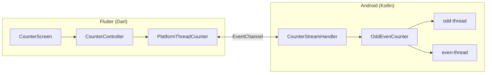
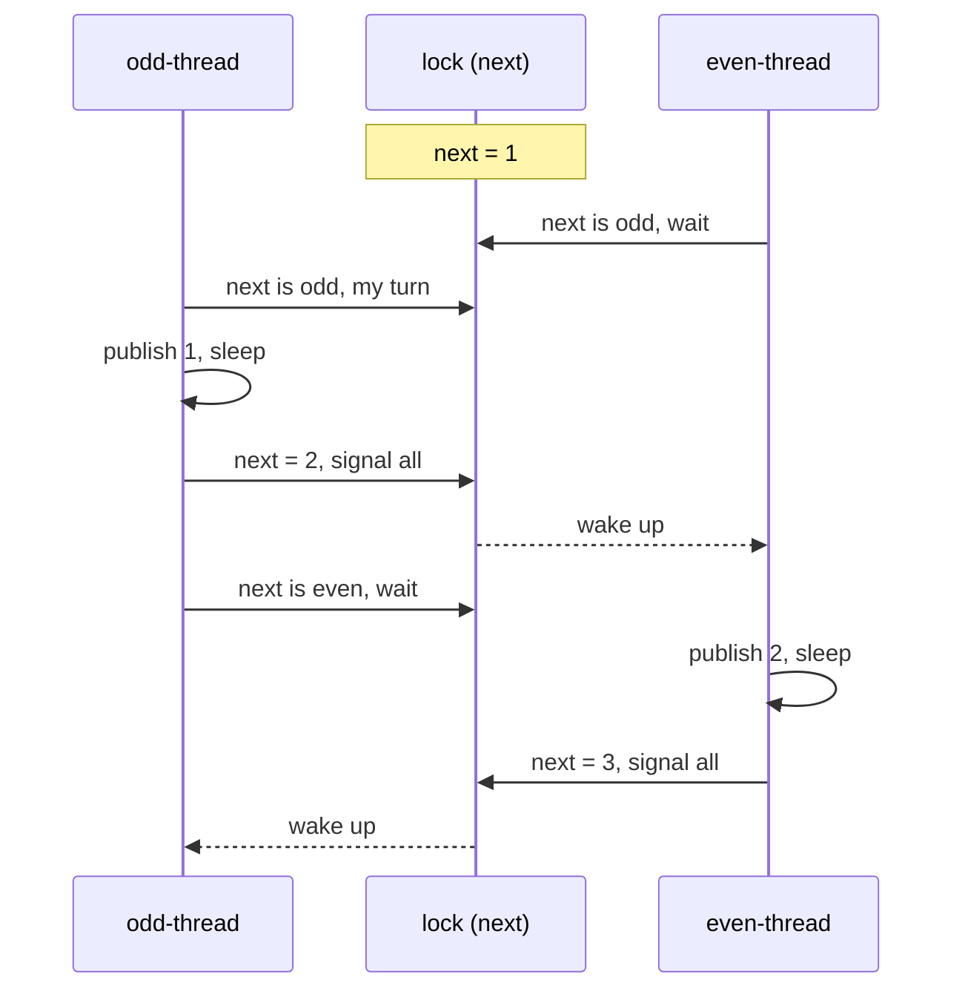

# Technical Specification: Odd/Even Thread Counter

- **Project:** Task 4 (Multithreading), spec-driven version
- **Document:** 2 of 3, technical specification
- **Status:** Approved, v1.0 (approved by Pedro Paula on 14 October 2026)
- **Author:** Pedro Paula, written with Claude Code
- **Date:** 14 October 2026
- **Based on:** [`01-functional-spec.md`](01-functional-spec.md) v1.0
- **Next document:** `03-implementation.md`, the implementation plan and its
  results, written while the code is built from this specification

## 1. Overview

The app has two parts:

- **Two real Android threads, written in Kotlin.** One counts odd numbers, the
  other even numbers. They share one piece of state, protected by a lock, and
  use it to take turns.
- **A Flutter user interface, written in Dart.** It starts and stops the run and
  shows each number as it arrives.

A Flutter `EventChannel` connects the two. Each number a thread publishes
becomes an event on a Dart stream, and the label shows it.

## 2. Key decision: what "thread" means

The functional specification (Q-1) requires real operating-system threads.
These were the options:

| Option | Pros | Cons | Decision |
| --- | --- | --- | --- |
| Dart isolates | Pure Dart; Flutter's own concurrency model | Isolates share no memory and communicate only by messages, so there is no lock and no shared state to synchronize on | Rejected. It also repeats the approach of the first version of this task. |
| Kotlin coroutines | Lightweight; idiomatic Kotlin | Coroutines are not threads; several can run on one thread | Rejected. The task asks for threads. |
| **Two Kotlin `Thread`s** synchronized with a lock | Literal match to the task; classic, well-understood synchronization | Needs a platform channel between Kotlin and Dart | **Chosen** |

For the lock itself, three Java/Kotlin primitives would work:

| Primitive | Notes | Decision |
| --- | --- | --- |
| `synchronized` with `wait()` / `notifyAll()` | The classic Java monitor. In Kotlin, `wait()` needs a cast to `java.lang.Object`. | Rejected, only for readability in Kotlin. |
| Two `Semaphore`s passed back and forth | Short, but the turn is implicit in the semaphore counts. | Rejected. |
| **`ReentrantLock` with a `Condition`** | Same monitor semantics; `withLock` reads well in Kotlin; waiting can be interrupted. The turn is explicit shared state. | **Chosen** |

## 3. Architecture



| Component | Language | File | Responsibility |
| --- | --- | --- | --- |
| `OddEvenCounter` | Kotlin | `OddEvenCounter.kt` | Creates the two threads and synchronizes them. Plain Kotlin with no Android dependencies, so it can be unit-tested on the JVM. |
| `CounterStreamHandler` | Kotlin | `CounterStreamHandler.kt` | Implements the `EventChannel` stream. Starts a run when Dart listens, stops it when Dart cancels, and moves every event to the main thread. |
| `MainActivity` | Kotlin | `MainActivity.kt` | Registers the channel and stops any run when the Flutter engine is cleaned up. |
| `PlatformThreadCounter` | Dart | `lib/counter/thread_counter.dart` | Opens the `EventChannel` stream and turns each message into a typed event. |
| `CounterController` | Dart | `lib/counter/counter_controller.dart` | Holds the screen state (status, current number, history) and the start and stop logic. |
| `CounterScreen` | Dart | `lib/ui/counter_screen.dart` | Draws the screen and reacts to the controller. |

## 4. Synchronization design

This is the core of the task.

### 4.1 Shared state

All shared state lives in `OddEvenCounter` and is only read or written while
holding `lock`:

| Field | Type | Meaning |
| --- | --- | --- |
| `lock` | `ReentrantLock` | Protects the fields below. |
| `turnChanged` | `Condition` of `lock` | Signalled every time the turn moves or the run stops. |
| `next` | `Int` | The next number to publish. Its parity says whose turn it is: odd means the odd thread, even means the even thread. Starts at 1. |
| `running` | `Boolean` | `false` once the run is stopped. |

### 4.2 Worker algorithm

Both threads run the same loop, each with its own parity:

```
loop:
    with lock:
        while running and next <= limit and next has the other parity:
            wait on turnChanged
        if not running or next > limit:
            exit loop
        value = next
    publish(value, parity)        // still our turn: next has not moved yet
    sleep(stepDelay)              // keep the number on screen (FR-6)
    with lock:
        next = value + 1          // hand the turn to the other thread
        signal all on turnChanged
```

Why this gives exactly 1, 2, 3, ... (FR-4, FR-5, NFR-1):

- Only the thread whose parity matches `next` can leave the wait, so only one
  thread holds the turn at any time.
- `next` only moves after the number has been published, and only the thread
  that published it moves it. Every number is therefore published once, in
  order.
- The order comes from the value of `next`, not from timing. The sleep only
  controls the pace. With a delay of zero the order is the same.
- The waiting thread is blocked on the condition, so it uses no CPU while it
  waits.

### 4.3 Example



### 4.4 Finishing and stopping

- **Finishing (FR-11):** when `next` passes the limit, both threads leave the
  loop. An `AtomicInteger` counts the threads still running; the last one to
  exit calls `onFinished`, unless the run was stopped.
- **Stopping (FR-10, FR-13):** `stop()` sets `running = false` under the lock,
  signals the condition and interrupts both threads, which also wakes a thread
  that is sleeping. Both threads exit without calling `onFinished`. Calling
  `stop()` more than once is safe.
- The threads are named `odd-thread` and `even-thread`, which makes them easy
  to identify in tests and in the debugger. They are daemon threads, so they can
  never keep the app process alive.

## 5. Platform channel contract

| Item | Value |
| --- | --- |
| Channel | `EventChannel` named `com.pedro.task4_spec_driven/counter` |
| Start a run | Dart listens to the stream with the arguments `{"limit": 20, "stepDelayMs": 500}` |
| Number event | `{"type": "number", "value": 7, "thread": "odd"}` |
| Finished event | `{"type": "finished"}`, followed by the end of the stream |
| Stop a run | Dart cancels its subscription; Kotlin's `onCancel` calls `stop()` |
| Invalid arguments | Error `INVALID_ARGUMENT`, and no threads are started |

Rules:

- **Main thread only.** Flutter requires channel messages to be sent on the
  Android main thread, so the handler posts every event with
  `Handler(Looper.getMainLooper()).post`. The main looper runs posts in order,
  and a thread only posts after the previous number has been posted, so the
  order is kept.
- **One run at a time.** A new listen stops any previous run before starting.
- **No events after a stop.** After `onCancel`, the stored event sink is
  cleared, and events still queued for it are dropped.

## 6. Flutter design

### 6.1 Event model

- `enum CounterThread { odd, even }`
- `sealed class CounterEvent` with two cases:
  - `NumberEvent(int value, CounterThread thread)`
  - `FinishedEvent()`
- `CounterEvent.fromMessage(Object? message)` decodes a channel message and
  throws a `FormatException` for anything it does not recognize.

### 6.2 `ThreadCounter`

An abstract class with one method:

```dart
Stream<CounterEvent> run({required int limit, required Duration stepDelay});
```

`PlatformThreadCounter` implements it with the `EventChannel`. Tests use a fake
implementation, so the controller and the screen can be tested without Android.

### 6.3 `CounterController`

A `ChangeNotifier` that owns the screen state:

| Field | Meaning |
| --- | --- |
| `status` | `idle`, `running`, `stopped` or `finished` |
| `currentValue` | The number in the label, or `null` before the first number |
| `currentThread` | The thread that published `currentValue` |
| `history` | Every number of the current run, in order, with its thread |
| `errorMessage` | Set if the platform reports an error |

| Action | From | To | Effect |
| --- | --- | --- | --- |
| `start()` | idle, stopped, finished | running | Clears the history and subscribes to `run(limit: 20, stepDelay: 500 ms)` |
| Number event | running | running | Updates the label and appends to the history |
| Finished event | running | finished | Keeps the last number |
| `stop()` | running | stopped | Cancels the subscription; keeps the last number |
| Stream error | running | stopped | Cancels the subscription and stores `errorMessage` |
| `dispose()` | any | n/a | Cancels the subscription, which stops the threads (FR-13) |

The limit (20) and the step delay (500 ms) are constants in the controller,
as decided in the functional specification (Q-2 to Q-4).

### 6.4 `CounterScreen`

Follows the layout in section 6 of the functional specification. It rebuilds
with `ListenableBuilder` when the controller changes. The label's background
color shows the thread that published the current number. Start and Stop are
enabled according to the state table in the functional specification.

## 7. Project structure

```
task4_spec_driven/
  docs/
    01-functional-spec.md
    02-technical-spec.md
    03-implementation.md
  lib/
    main.dart
    counter/
      thread_counter.dart          event model, ThreadCounter, PlatformThreadCounter
      counter_controller.dart
    ui/
      counter_screen.dart
  test/
    counter_event_test.dart
    counter_controller_test.dart
    counter_screen_test.dart
  android/app/src/
    main/kotlin/com/pedro/task4_spec_driven/
      MainActivity.kt
      CounterStreamHandler.kt
      OddEvenCounter.kt
    test/kotlin/com/pedro/task4_spec_driven/
      OddEvenCounterTest.kt
```

The project is created with `flutter create --platforms android`, so it targets
Android only.

## 8. Testing strategy

| Level | Tool | What is tested |
| --- | --- | --- |
| Synchronization | JUnit 4 on the JVM | `OddEvenCounter` publishes exactly 1 to the limit in order. Each number is published by the thread with the right name (`odd-thread` or `even-thread`). The run is repeated many times with no delay, to catch race conditions. `stop()` ends a run early and suppresses `onFinished`. Limits of 1 and 0 behave correctly. |
| Channel decoding | `flutter_test` | `CounterEvent.fromMessage` accepts valid messages and rejects invalid ones. |
| Controller | `flutter_test` with a fake `ThreadCounter` | Every transition in the state table, including stopping, restarting and errors. Events after a stop are ignored. |
| Screen | Widget tests with the fake | The idle screen (AC-1), the running screen and the button states. |
| Static analysis | `flutter analyze` | No issues. |
| End to end | Release APK on the Android emulator, by hand | AC-2 to AC-7. |

## 9. Traceability

| Requirement | Design | Test |
| --- | --- | --- |
| FR-1, FR-2 | Two `Thread`s, `odd-thread` and `even-thread` (4.4) | JUnit: thread names and parity |
| FR-3 | One `EventChannel` stream feeds one label (5, 6.4) | Widget test |
| FR-4, FR-5, NFR-1 | Turn held in `next` under the lock (4.1, 4.2) | JUnit: exact sequence, repeated with no delay |
| FR-6 | `sleep(stepDelay)` while holding the turn (4.2) | Manual |
| FR-7, FR-8 | `currentThread` and `history` in the controller (6.3) | Controller and widget tests |
| FR-9, FR-10, FR-12 | Controller actions and button states (6.3, 6.4) | Controller and widget tests; JUnit for `stop()` |
| FR-11 | Last thread to exit calls `onFinished` (4.4) | JUnit; controller test |
| FR-13 | Cancel stops the threads; engine clean-up stops any run (4.4, 5) | JUnit for `stop()`; manual |
| NFR-2 | Counting runs off the main thread; the UI only receives events (5) | Manual (AC-6) |
| NFR-3 | Tests above | All |

## 10. Build and delivery

- Flutter 3.47.6 and Dart 3.13.5, with Kotlin for the Android side.
- Application ID `com.pedro.task4_spec_driven`, launcher name "Odd/Even
  Threads", so it can be installed next to the first version.
- Release APK: `apk/task4_spec_driven.apk` at the repository root.
- The implementation phase records its plan, its progress and the test results
  in `03-implementation.md`.

## 11. Risks

| Risk | Mitigation |
| --- | --- |
| An event arrives after Dart has cancelled | The sink is checked and cleared on the main thread, so late events are dropped. |
| The activity is destroyed during a run | `MainActivity` stops the run when the Flutter engine is cleaned up. |
| A thread is interrupted while waiting or sleeping | `InterruptedException` ends the loop cleanly. |
| A race condition that only shows up rarely | The JUnit test repeats the run many times with no delay. |

## Revision history

| Version | Date | Change |
| --- | --- | --- |
| 0.1 | 14 October 2026 | First draft, from the approved functional specification. |
| 1.0 | 14 October 2026 | Approved without changes. |
